# Velora

**一个自己折腾着玩的极简 Android 巡航仪表——专门给平时喜欢开快车、又不想被路边突然冒出来的测速摄像头偷拍的司机准备的。**

平时开车不爱开着吵闹的地图导航一直指路，但又想知道这条路到底限速多少、前面有没有电子眼、区间平均跑超了没有、路口红绿灯还有几秒——Velora 就是为了这个随手攒出来的。顺手也接了**完整的百度地图搜索和路线导航**，真要找路也能直接开着走。

它里面的**当前道路限速、前方测速提醒、区间测速和红绿灯倒计时，全部靠百度地图开放平台提供真实数据**；有真数据就干净地亮出来提醒你，没信号或者服务没开的时候就安安静静不显示，绝不瞎猜乱报。

Android 8.0+ · arm64-v8a · v2.9.4

[在线体验网页演示](https://zouhhx.github.io/Velora/) · [直接下 APK 玩玩](https://github.com/zouhhx/Velora/releases) · [顺手写的文档](https://github.com/zouhhx/Velora/tree/main/project-docs)

<table>
  <tr>
    <td align="center">
      <a href="docs/images/cruise.png">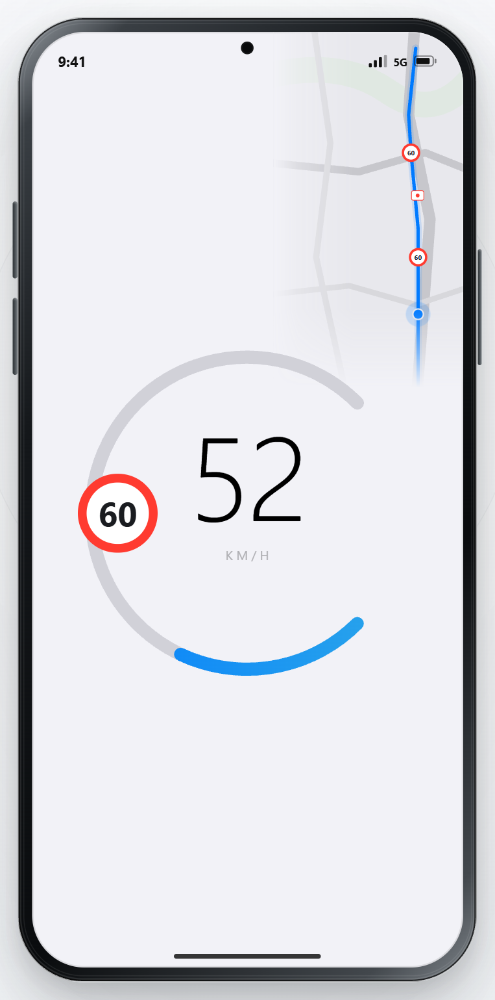</a><br>
      <sub>巡航限速</sub>
    </td>
    <td align="center">
      <a href="docs/images/camera.png"></a><br>
      <sub>前方电子眼（底部胶囊提醒）</sub>
    </td>
    <td align="center">
      <a href="docs/images/overspeed.png"></a><br>
      <sub>超速预警（&lt;10%）仅变红</sub>
    </td>
  </tr>
  <tr>
    <td align="center">
      <a href="docs/images/overspeed-severe.gif">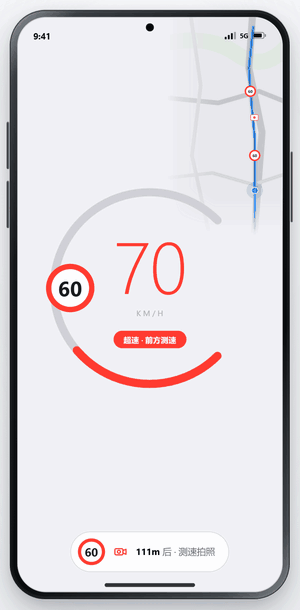</a><br>
      <sub>超速预警（&gt;10%）红色闪烁</sub>
    </td>
    <td align="center">
      <a href="docs/images/traffic-light.png">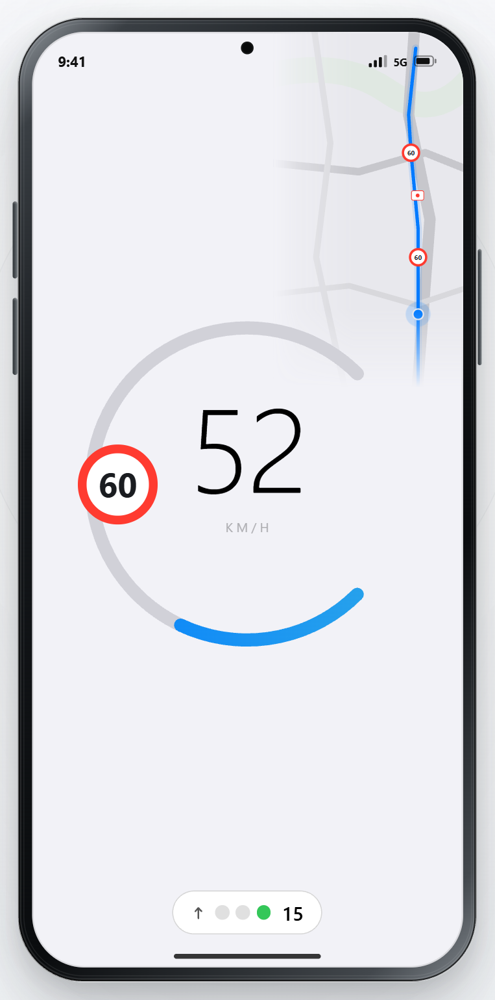</a><br>
      <sub>红绿灯状态和倒计时</sub>
    </td>
    <td align="center">
      <a href="docs/images/interval.png"></a><br>
      <sub>区间测速</sub>
    </td>
  </tr>
</table>

## 先在网页上试一下

懒得装 APK 的话，直接点开 **[在线交互演示](https://zouhhx.github.io/Velora/)** 就能看动态效果——左边是一段极简模拟路况，右边手机画面实时联动（正常巡航 → 路口绿灯 → 电子眼超速变红闪烁 → 区间测速）。也可以把 [`docs/index.html`](docs/index.html) 下到本地双击打开。

## 里面都有啥

- **极简巡航限速**：只留一个大车速环和当前道路限速，能自己调超速阈值；没数据就不乱显示。
- **电子眼 & 区间测速**：前方 800 米内弹出电子眼提醒，进区间后会算平均车速和剩多少米出区间。
- **路口红绿灯倒计时**：快到路口时底部弹出灯色和读秒。
- **地图与导航**：内置百度地图浏览、地点搜索、路线规划和后台/锁屏语音导航（虽然体验一般，下面有吐槽）。
- **0–100 km/h 加速测试**：藏在设置页里，纯靠本地 GPS 算成绩、记历史最佳；右上角带一个**加速度计辅助计算**开关（默认关闭），开启后用加速度计帮忙抓起步瞬间来补偿 GPS 延迟。

> **看界面猜信号的小技巧**：  
> - 只要手机连上网拿到大致位置，**主页右上角的小地图**就会出现；  
> - **只有走到室外、GPS 精度达标时，中央的速度计圆环才会显示**——如果速度计没出来，直接说明当前 GPS 信号差或者头顶有遮挡。

### 零百加速与辅助开关

入口在 **设置 → 性能测试 → 零百加速**。页面右上角的 **「加速度计辅助计算」** 默认关闭；开启后，加速度计只负责辅助判断起步瞬间，最终成绩仍以 GPS 速度和时间戳为准，不会拿传感器数值硬凑成绩。

## 怎么用

### 设置页在哪？（第一次用必看）

主界面为了干净没放设置按钮：

1. 点一下巡航主页**右上角的小地图区域**，会切到完整地图页；
2. 完整地图页**右上角就有设置（⚙）按钮**；
3. 进去点 **数据服务与密钥**，就能填自己的 AK / TTS Key，或者一键复制包名和签名 SHA-1。

> **小提示**：如果你是自己拉源码编译且还没填 `baidu.map.ak`，主页右上角小地图会是空白的——**别慌，直接点那块空白区域一样能进地图页找到设置**。

### 方式一：直接装 APK（推荐）

去 [Releases](https://github.com/zouhhx/Velora/releases) 下最新的公开安装包就行。公开包里已经内置了我的基础地图 AK，**装上就能直接看地图、导航、用 GPS 车速表和测零百**。

> 公开包目前是 debug 签名，自己长期用或上架的话，记得换成自己的 release 签名，并重新绑定地图 AK。

### 方式二：自己拉源码编译

需要 Windows PowerShell、JDK 17、Android SDK 36。

```powershell
git clone https://github.com/zouhhx/Velora.git
cd Velora
Copy-Item local.properties.example local.properties

# 填入你自己的 baidu.map.ak；可选填 horizon.ak / mimo.api.key
.\test.ps1
.\gradlew.bat assembleDebug
```

构建产物在 `app/build/outputs/apk/debug/app-debug.apk`。`local.properties` 已被 `.gitignore` 排除，别把它和 AK 一起提交上去。

## 更多实机图与折腾笔记

### 导航功能实机截图 & 真实吐槽

导航功能其实我花了好久去打磨，搜索路线、多方案切换、3D 导航和锁屏语音播报都是能跑通的——但百度导航 SDK 9.0.2 遗留了几个修了好多次都实在修不动的毛病：

- 退出导航回到地图浏览页后，图层不对，仍然显示导航的图层，而不是地图浏览页的图层；
- 导航时仍会画出备选路线和路线对比气泡，百度 9.0.2 没有可用的关闭接口，当前版本关不掉；
- 导航时不可单指滑动地图，只能双指放大和缩小，旋转；且进入导航默认比例尺不对导致无法绘制车道级地图，手动放大即可解决；

所以现在的导航属于“应急能用，但别指望它比高德/百度地图客户端好用”。万一在里面遇到显示卡死或退出地图不恢复，最管用的解决办法就是——**直接划掉软件重新打开**。

<table>
  <tr>
    <td align="center"><a href="docs/images/map-browse.jpg">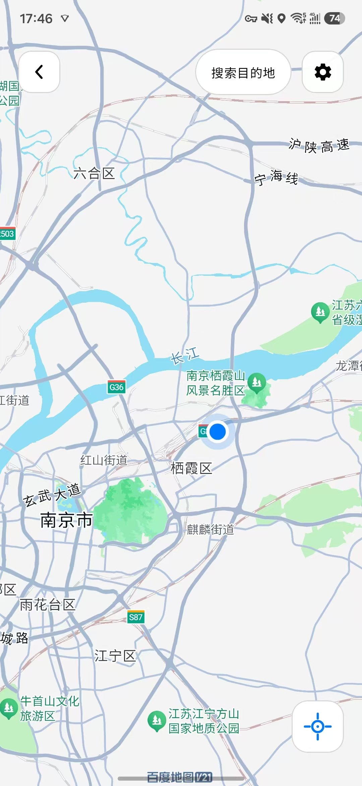</a><br><sub>完整地图页</sub></td>
    <td align="center"><a href="docs/images/nav-search.jpg">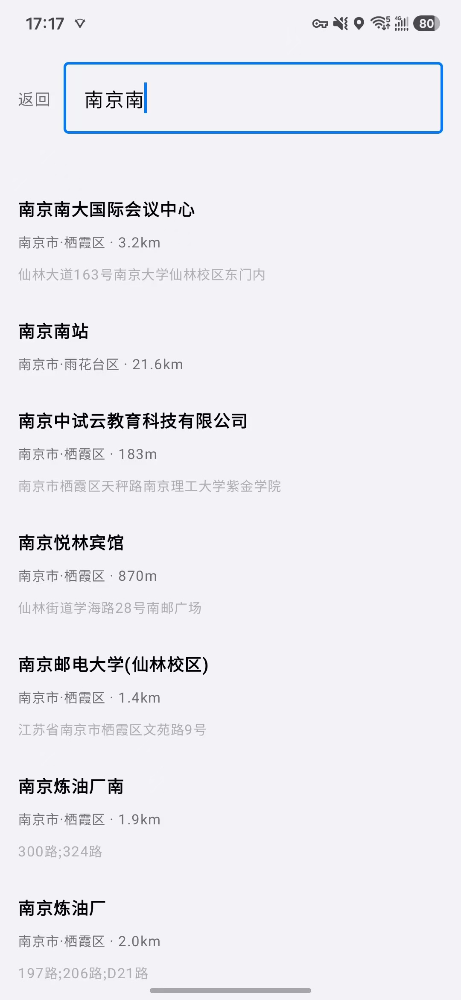</a><br><sub>搜索目的地</sub></td>
    <td align="center"><a href="docs/images/nav-route.jpg">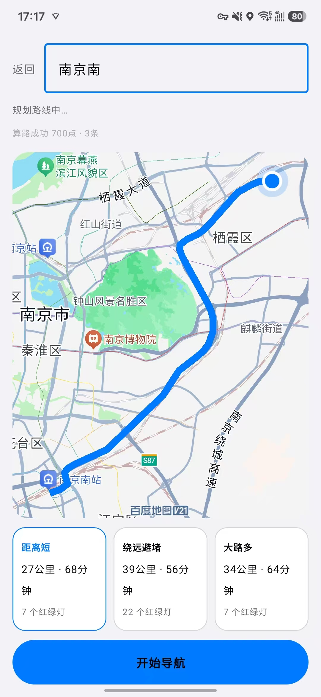</a><br><sub>路线方案</sub></td>
  </tr>
  <tr>
    <td align="center"><a href="docs/images/nav-3d.jpg">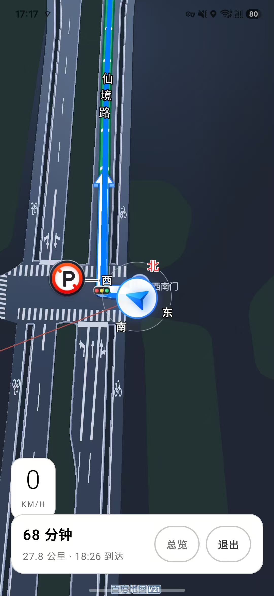</a><br><sub>3D 导航</sub></td>
    <td align="center"><a href="docs/images/settings-home.jpg">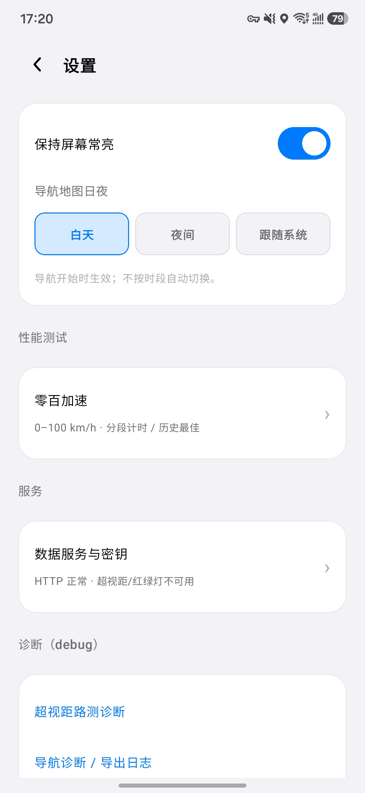</a><br><sub>设置首页</sub></td>
    <td align="center"><a href="docs/images/zero100.jpg">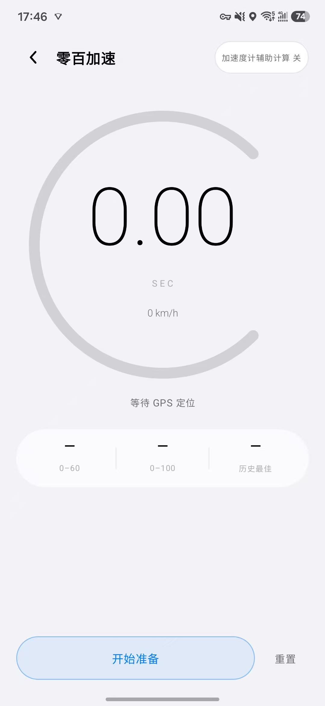</a><br><sub>零百加速</sub></td>
  </tr>
</table>

### 为什么用百度 + 两套 AK 手把手申请

#### 为什么用百度？高级服务过期了会怎样？

很多人肯定会想：“高德、腾讯不行吗？”——我早就调研过了，那两家公开开放平台给的巡航限速和红绿灯数据还不如百度多，更实现不了。

Velora 的核心巡航能力依赖百度地图开放平台的两个高级服务：

- 当前道路限速 & 电子眼：依赖百度的 **超视距巡航(websocket长连接)**；
- 路口红绿灯倒计时：依赖百度的 **红绿灯服务**。

这两项都不是永久免费的，需要单独提交工单申请，而且一般只给半个月（15 天）试用期。一旦试用期过了，这软件最核心的限速、电子眼和红绿灯提示就相当于“残废”了，只剩基础地图、导航、GPS 车速表和零百加速能用。

#### 手把手自己申请两套 AK

**1）服务端 AK（管超视距限速、电子眼、红绿灯）**

1. 点「创建应用」，应用类型选 **服务端**；
2. 往下拉找到 **高级服务**，找到 **超视距巡航(websocket长连接)** 和 **红绿灯服务**；
3. 点开提交工单申请（说明个人测试用途，基本都会给过，但只有半个月试用期）。

**2）Android 应用端 AK（管地图显示、搜索、导航）**

1. 再点一次「创建应用」，应用类型选 **Android应用**；
2. 如果你自己改代码重签编译：PackageName 和 SHA-1 填你自己的（App 设置页可以直接一键复制）；
3. 如果你直接装我 Releases 里的公开 APK：PackageName 填 `com.zouhu.speedlimit`，开发版/发布版 SHA-1 填：

```text
BB:27:23:23:0A:06:55:5D:F9:51:2F:D4:F2:FE:07:26:CC:9F:D1:5E
```

拿到 AK 后填进 App 的 **设置 → 数据服务与密钥**（如需导航语音播报，顺手再填个小米 `mimo.api.key`）。

#### 百度控制台截图（5 张）

<table>
  <tr>
    <td align="center"><a href="docs/images/baidu-console-server-app.png">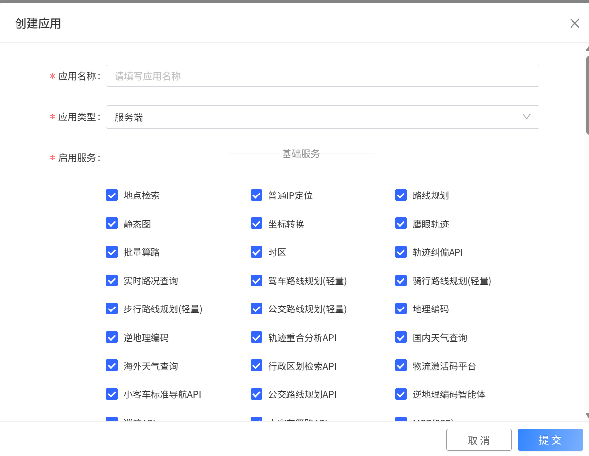</a><br><sub>创建服务端应用</sub></td>
    <td align="center"><a href="docs/images/baidu-console-advanced-websocket.png">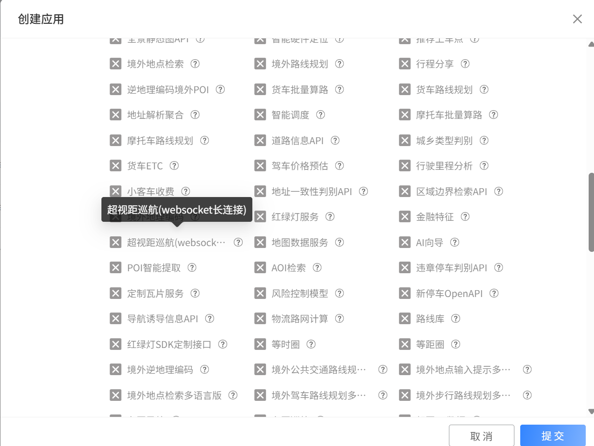</a><br><sub>高级服务 · 超视距巡航</sub></td>
  </tr>
  <tr>
    <td align="center"><a href="docs/images/baidu-console-traffic-light.png">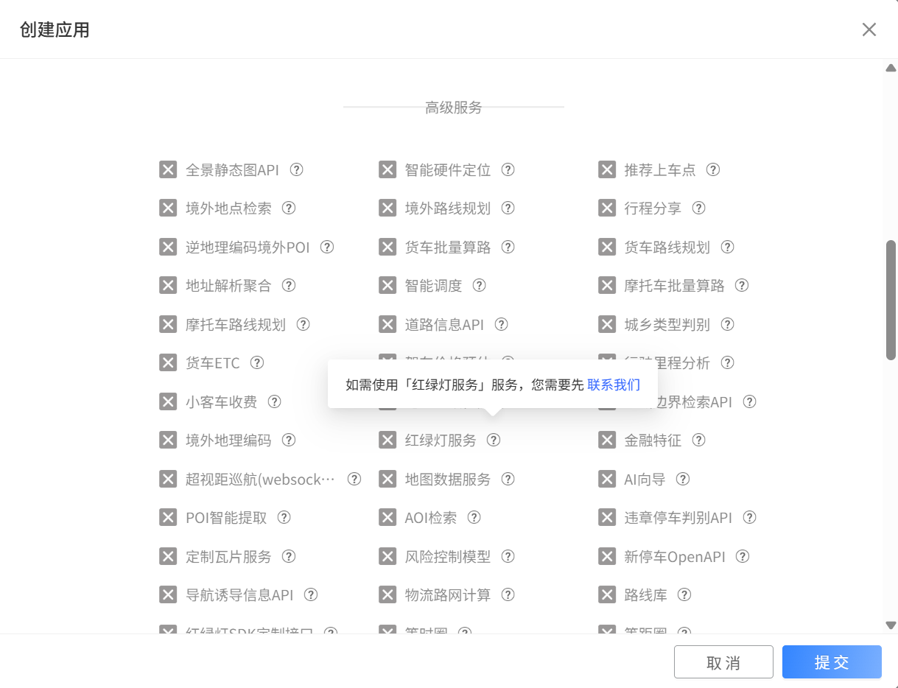</a><br><sub>红绿灯服务 · 工单提示</sub></td>
    <td align="center"><a href="docs/images/baidu-console-android-app.png">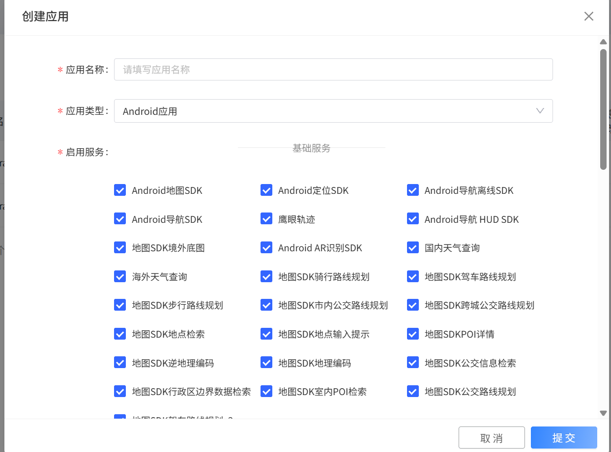</a><br><sub>创建 Android 应用</sub></td>
  </tr>
  <tr>
    <td align="center" colspan="2"><a href="docs/images/baidu-console-android-sha1.png">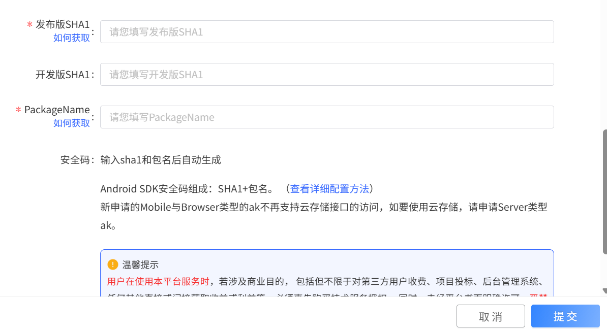</a><br><sub>填写 PackageName / SHA-1</sub></td>
  </tr>
</table>

## 用了什么写的

Kotlin 2.2 · Jetpack Compose (Material 3) · 百度地图导航 SDK 9.0.2 · OkHttp · EncryptedSharedPreferences

## 随便说说

纯个人兴趣折腾的小玩具，过程里攒的杂七杂八文档都放在 [文档目录](https://github.com/zouhhx/Velora/tree/main/project-docs) 里。觉得好玩欢迎提 Issue / PR；反馈问题时记得附上手机型号和复现步骤，注意别把自己的真实住址或 AK 截图传上来。

> 地图、导航、限速、电子眼与红绿灯数据均由百度地图开放平台提供，请遵守对应服务条款。安全驾驶，别真拿命开快车。
