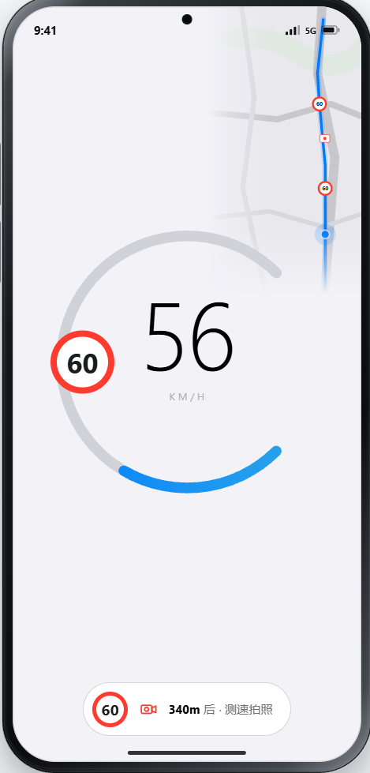
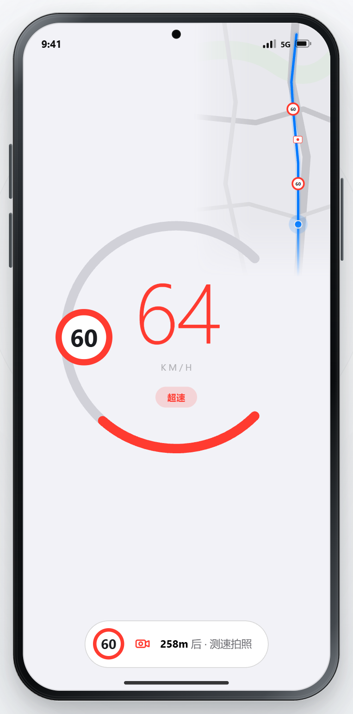
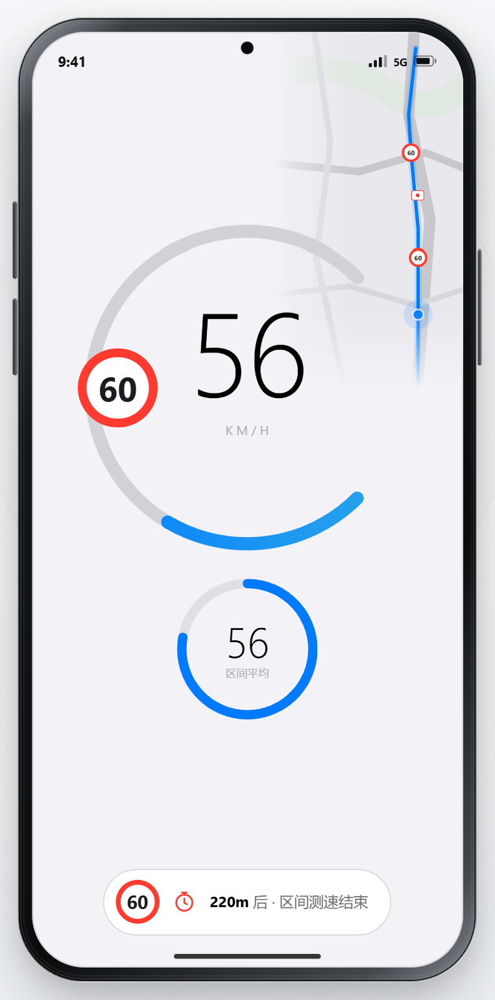

# Velora

**一款把限速、电子眼测速、红绿灯灯态倒计时与导航收进同一块简洁主页的开源 Android 驾驶助手。**

Velora 只在有可信定位和真实道路数据时显示数值；没有有效数据时不显示，也不猜测或伪造。  
Android 8.0+ · arm64-v8a · v2.9.4

[在线交互演示](#在线交互演示) · [下载 APK](../../releases) · [项目文档](project-docs/README.md)

<table>
  <tr>
    <td align="center">
      <a href="docs/images/cruise.png"></a><br>
      <sub>巡航限速</sub>
    </td>
    <td align="center">
      <a href="docs/images/camera.png"></a><br>
      <sub>前方电子眼</sub>
    </td>
    <td align="center">
      <a href="docs/images/overspeed.png"></a><br>
      <sub>超速预警</sub>
    </td>
  </tr>
  <tr>
    <td align="center">
      <a href="docs/images/overspeed-severe.gif"></a><br>
      <sub>严重超速 · 红色闪烁</sub>
    </td>
    <td align="center">
      <a href="docs/images/traffic-light.png"></a><br>
      <sub>红绿灯倒计时</sub>
    </td>
    <td align="center">
      <a href="docs/images/interval.png"></a><br>
      <sub>区间测速</sub>
    </td>
  </tr>
</table>

## 在线交互演示

左侧是动态道路舞台，右侧是 Velora 手机界面，两边由同一套 4 段路况剧本同步驱动：正常巡航 → 路口绿灯 → 电子眼超速 → 区间测速。

> **GitHub Pages**：仓库 `Settings → Pages → Source` 选择 `main` / `/docs`，然后访问  
> `https://<your-user>.github.io/<repo>/`
>
> **本地预览**：下载 [`docs/index.html`](docs/index.html)，双击用浏览器打开即可。单文件、零依赖，不需要服务器。

## 核心功能

- **极简巡航限速**：当前道路限速、车速环与可调超速阈值；数据不可信时自动隐藏。
- **800m 电子眼与区间测速**：显示前方测速距离、区间起终点、平均速度与剩余里程。
- **路口红绿灯倒计时**：多方向灯态与倒计时；导航界面另有独立的红绿灯提示。
- **百度地图与导航**：地图浏览、地点搜索、路线导航；导航语音支持后台与锁屏播报。
- **0–100 km/h 加速测试**：设置页独立入口，读取 GPS 计算成绩并保存历史最佳；可选加速度计起步辅助，默认关闭，不参与计时。
- **无数据不伪造**：服务未配置、过期或信号不足时，只显示等待/不可用，不编造限速、灯态或成绩。

## 快速上手

### 进入设置页

1. 在巡航主页点击**右上角的迷你地图区域**，进入完整地图页。
2. 在完整地图页**右上角点击设置（⚙）按钮**。
3. 选择 **数据服务与密钥**，即可填写服务 AK、TTS Key，或复制本包包名与签名 SHA-1（安全码）。

> **源码构建用户注意**：即使尚未配置 `baidu.map.ak`，主页右上角地图区域可能显示为空白，点击这块空白区域仍然可以正常进入地图页并打开设置，直接填入密钥。

### 方式一：下载 APK

前往 [GitHub Releases](../../releases) 下载最新公开 APK。

公开包已内置地图 AK，安装后即可使用地图、导航、基础车速表与 0–100 km/h 加速测试。  
超视距、红绿灯与语音播报属于可选服务：在 `设置 → 数据服务与密钥` 填入自己的服务 AK 或 TTS Key 即可。页面会显示本包名与签名 SHA-1（百度控制台绑定 Android 应用所需的安全码），支持一键复制。

> 当前公开包使用 debug 签名，适合直接体验。如需上架或长期分发，请配置自己的 release 签名，并重新绑定百度地图 AK。

### 方式二：从源码构建

需要 Windows PowerShell、JDK 17、Android SDK 36。

```powershell
git clone https://github.com/<your-user>/<repo>.git
cd <repo>
Copy-Item local.properties.example local.properties

# 填入 baidu.map.ak；可选填入 horizon.ak / mimo.api.key
.\test.ps1
.\gradlew.bat assembleDebug
```

- 构建产物：`app/build/outputs/apk/debug/app-debug.apk`
- `local.properties` 已被 `.gitignore` 排除，请勿提交或分享。
- 地图 AK 需要绑定包名 `com.zouhu.speedlimit` 与本机签名 SHA-1；App 设置页可直接复制这两项。

## 设置与密钥

所有配置都在 App 的 `设置 → 数据服务与密钥` 中管理。值加密保存在本机并脱敏显示；地图 AK 修改后需重启 App，服务 AK 保存后立即重连。

| 配置 | 用途 | 获取方式 |
|---|---|---|
| `baidu.map.ak` | 地图、导航、地点搜索 | 百度地图开放平台 Android 应用；绑定包名 + 签名 SHA-1。公开 APK 已内置 |
| `horizon.ak` | 超视距、HTTP 巡航、红绿灯服务 | 百度服务端应用；高级服务需提交百度工单单独开通 |
| `mimo.api.key` | 导航语音 TTS | 小米 MiMo 控制台 |

从源码构建时，`local.properties` 只作为编译期回退；运行时的本机配置优先。未配置服务 AK 或 TTS Key 时，基础地图、导航、车速表与加速测试仍可正常使用。

## 已知限制

- **百度地图/导航 SDK 9.0.2**：退出导航后，底图兴趣点与单指拖动在个别情况下不会立即恢复；重新进入地图或重启 App 可恢复浏览。
- 部分导航场景仍可能显示备选路线；当前 SDK 版本无法可靠地只保留主路线。
- 巡航时的车道级引导需要额外的百度商业授权，因此默认不显示；导航时的车道图属于另一条链路。
- 超视距与红绿灯服务属于百度高级服务，需要单独申请工单；未开通时相关卡片会显示不可用，不影响基础功能。
- 没有配置 TTS Key 时，导航语音不会播报。

## 技术栈

- Kotlin 2.2 + Jetpack Compose（Material 3）
- `compileSdk 36` / `minSdk 26` / `targetSdk 34`，`arm64-v8a`
- 百度地图导航 SDK 9.0.2、百度检索 SDK 9.0.0
- OkHttp、kotlinx.serialization、DataStore、EncryptedSharedPreferences

## 参与贡献

欢迎提交 Issue 和 Pull Request。

- 提交前请运行 `.\test.ps1` 与 `.\gradlew.bat assembleDebug`。
- 请勿提交 `local.properties`、AK/SK、TTS Key、签名证书、APK 或诊断日志。
- 反馈定位/导航问题时，请附设备型号、Android 版本、复现步骤和已脱敏截图；不要包含真实住址、车牌或账号。

## 文档

- [项目文档索引](project-docs/README.md)
- [架构说明](project-docs/ARCHITECTURE.md)
- [产品需求](project-docs/PRODUCT_REQUIREMENTS.md)
- [已确定决策与边界](project-docs/DECISIONS_AND_BOUNDARIES.md)

## 安全

本仓库不包含真实服务端密钥、签名证书或诊断日志。若发现密钥泄露或安全问题，请先轮换相关密钥，再私下联系维护者；不要在公开 Issue 中粘贴 AK/SK/Key。

地图、导航与高级数据由百度地图开放平台提供，使用前请确认相应 SDK 与服务条款。
